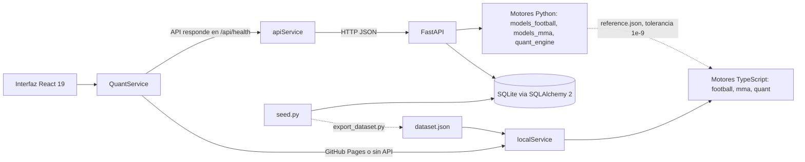
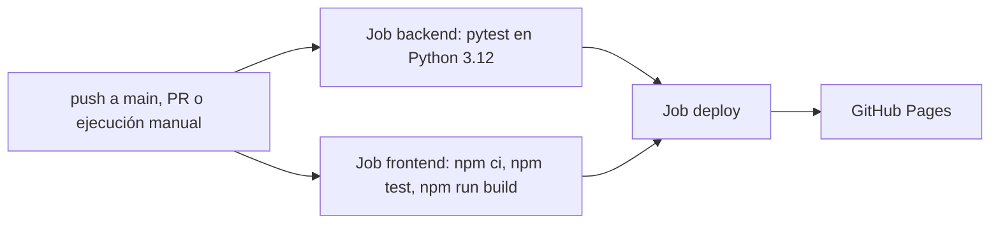

# QuantEdge Sports AI

**Simulador cuantitativo de fútbol y MMA: Poisson bivariante, Dixon-Coles, Elo, Monte Carlo, apuestas de valor con Kelly y backtesting sin fuga de información. Corre con una API FastAPI o 100 % en el navegador.**

[](https://github.com/dftii/quantedge-sports-ai/actions/workflows/deploy.yml)


### [>> Demo en vivo: dftii.github.io/quantedge-sports-ai <<](https://dftii.github.io/quantedge-sports-ai/)

> **Aviso:** los **nombres** de clubes y peleadores son reales, pero las estadísticas por equipo y por peleador son valores **aproximados** transcritos a mano de fuentes públicas (temporada 2023/24 al estilo FBref / Understat; estadísticas de carrera de UFCStats hacia mediados de 2024) y pueden contener **inexactitudes**. Los partidos y peleas del **historial** y todas las **cuotas** son **simulados** (semilla fija `numpy.random.default_rng(42)`): esos enfrentamientos concretos **no ocurrieron** y las cuotas no son precios de mercado; los próximos eventos son hipotéticos. El proyecto no está afiliado a ningún club, liga ni a la UFC. Los pesos del modelo de MMA están **fijados a mano**, **no ajustados** con datos reales. Es una demostración técnica, no una herramienta de apuestas ni asesoramiento financiero.

## Qué es

Un proyecto de portfolio que implementa de punta a punta un stack de analítica deportiva cuantitativa:

- **Fútbol:** matriz de marcadores con **Poisson bivariante** + corrección de **Dixon-Coles**, ratings **Elo** con multiplicador de diferencia de goles y un predictor por perfiles (xG, posesión, Elo). El ajuste por máxima verosimilitud de Dixon-Coles con decaimiento temporal está disponible en la API.
- **MMA:** probabilidad de victoria con un modelo **logístico multifactor**, más reparto por método (KO/TKO, sumisión, decisión) y distribución por asalto.
- **Cuantitativo:** simulación **Monte Carlo** (10.000 por defecto) con intervalos de Wilson, eliminación del margen de la casa, **valor esperado (+EV)** y **criterio de Kelly** fraccional, y **backtesting walk-forward** de fútbol con Brier, log-loss, calibración, ROI y curva de bankroll.
- **Dos modos de ejecución** con la misma interfaz y los mismos motores (ver abajo).

Resultados medibles del propio repositorio: **95 tests de backend (pytest)** y **32 tests de frontend (vitest)**; el puerto TypeScript se valida contra salidas de referencia de Python con tolerancia 1e-9.

## Dos modos de ejecución

| | Modo API | Modo navegador |
|---|---|---|
| Dónde | Backend FastAPI en `http://localhost:8000` | GitHub Pages o cualquier build estático |
| Motores | Python (`backend/app/engines/`) | Puerto TypeScript (`frontend/src/engine/`) |
| Datos | SQLite sembrada por `seed.py` | `frontend/src/data/dataset.json`, generado desde el mismo seed |
| Extras | Persistencia de simulaciones, CRUD, export CSV/JSON, ajuste MLE de Dixon-Coles | Sin servidor ni instalación |

**Detección automática** (`frontend/src/services/index.ts`):

1. Si el host termina en `.github.io` o `VITE_FORCE_LOCAL=1`, se usa el modo navegador.
2. Si no, se hace `GET {VITE_API_URL}/api/health` (por defecto `http://localhost:8000`) con un timeout de **1,5 s**; si responde OK se usa la API.
3. Si falla o no responde, se cae al modo navegador.

Ambos modos implementan la misma interfaz `QuantService` (`frontend/src/engine/types.ts`), cuyas formas replican las respuestas de FastAPI.

**Validación cruzada.** `backend/tests/make_ts_reference.py` genera `frontend/src/engine/__fixtures__/reference.json` con salidas de los motores de Python (goles esperados, ajustes, matrices Dixon-Coles y mercados, predicciones de MMA, eliminación del vig, EV, Kelly, predicciones walk-forward y informe de backtest). `reference.test.ts` comprueba que el puerto TypeScript coincide con tolerancia **1e-9**.

Límites del puerto, por honestidad:

- El **ajuste MLE de Dixon-Coles** (`DixonColesModel`) **solo existe en Python** (opción `use_dixon_coles_fit` de `/api/simulate/football`); el modo navegador usa el predictor por perfiles y el cliente TypeScript no envía esa opción.
- El Monte Carlo del navegador usa un PRNG propio (mulberry32) con semilla reproducible, pero **no reproduce el flujo de NumPy**: las salidas analíticas coinciden con Python, las muestras aleatorias no son idénticas bit a bit.

## Arquitectura



**CI/CD** (`.github/workflows/deploy.yml`):



En los pull requests solo se ejecutan los tests y el build; el despliegue a GitHub Pages ocurre únicamente fuera de PR (push a `main` o ejecución manual) y solo si pasan ambos jobs.

## Funcionalidades de la interfaz

- **Selector Fútbol / MMA** para cambiar de deporte sin recargar.
- **Simulador H2H** con sliders en vivo: factor cancha, forma y bajas (hasta 5 por equipo) en fútbol; forma de cada peleador en MMA. Cada cambio recalcula la predicción y lanza **10.000 simulaciones Monte Carlo** cuya distribución se muestra animada.
- **Mapa de calor de marcadores** (fútbol) y **desglose de métodos de victoria** (MMA: KO/TKO, sumisión, decisión y asalto de finalización).
- **Escáner +EV y Kelly:** introduce cuotas, el sistema quita el margen de la casa, calcula edge, valor esperado y stake de Kelly fraccional sobre tu bankroll.
- **Backtesting walk-forward** de fútbol: Brier, log-loss, calibración, ROI y curva de bankroll.
- Funciona igual en ambos modos (misma interfaz `QuantService`).

## Fundamentos matemáticos

### Fútbol

**Poisson bivariante** (Karlis y Ntzoufras). Con $X_1, X_2, X_3$ Poisson independientes de medias $\lambda_1, \lambda_2, \lambda_3$:

$$X = X_1 + X_3,\quad Y = X_2 + X_3,\quad P(x,y) = \sum_{k=0}^{\min(x,y)} \mathrm{Pois}(k;\lambda_3)\,\mathrm{Pois}(x-k;\lambda_1)\,\mathrm{Pois}(y-k;\lambda_2)$$

Introduce covarianza $\mathrm{Cov}(X,Y)=\lambda_3$; con $\lambda_3 = 0$ se reduce a dos Poisson independientes. Se usa $\lambda_1=\lambda-\lambda_3$ y $\lambda_2=\mu-\lambda_3$ para que las medias marginales sigan siendo $\lambda$ y $\mu$. La malla se trunca en `max_goals` y se renormaliza; el cálculo es un producto de matrices Toeplitz triangulares, sin bucles sobre la malla.

**Dixon-Coles.** Corrige las puntuaciones bajas multiplicando la malla por $\tau$ (con $\rho$ recortado al rango en el que todo $\tau \ge 0$):

$$\tau(x,y)=\begin{cases}1-\lambda\mu\rho & (0,0)\\ 1+\lambda\rho & (0,1)\\ 1+\mu\rho & (1,0)\\ 1-\rho & (1,1)\\ 1 & \text{resto}\end{cases}$$

El ajuste por máxima verosimilitud (API) estima ataque, defensa, ventaja local y $\rho$ con decaimiento temporal $w_m = e^{-\xi\,\Delta t_m}$ ($\xi = 0{,}0019$ por día, semivida de aproximadamente un año):

$$\ell = \sum_m w_m\left[\ln\tau + x\ln\lambda - \lambda + y\ln\mu - \mu\right],\quad \ln\lambda = c + \gamma + a_{\mathrm{local}} + d_{\mathrm{visitante}}$$

**Elo con multiplicador de diferencia de goles** (K = 20, ventaja local $H$ = 65):

$$W_e = \frac{1}{1+10^{-(R_h + H - R_a)/400}},\qquad \Delta R = K\cdot G\cdot(W - W_e),\quad G=\begin{cases}1 & \text{margen} \le 1\\ 1{,}5 & \text{margen} = 2\\ (11+n)/8 & n\ge3\end{cases}$$

**Predictor por perfiles.** Con $L$ = goles medios por equipo de la liga, $h$ = 1,12 (ventaja local), $dr$ = rating defensivo opcional (la API y el navegador usan $dr = 1$, porque el xG concedido ya mide la defensa) y $\Delta p$ = diferencia de posesión en puntos:

$$\ln\lambda_{\mathrm{stats}} = \ln\frac{xG^{h}_{\mathrm{for}}\; xG^{a}_{\mathrm{against}}}{L\cdot dr_a} + \ln h + 0{,}003\,\Delta p,\qquad \ln\mu_{\mathrm{stats}} = \ln\frac{xG^{a}_{\mathrm{for}}\; xG^{h}_{\mathrm{against}}}{L\cdot dr_h} - \ln h - 0{,}003\,\Delta p$$

Mezcla con Elo: se conserva el total logarítmico $g=(\ln\lambda+\ln\mu)/2$ y se mezcla la razón $r = (1-w)\ln(\lambda/\mu) + w\left(2\ln h + (E_h-E_a)/500\right)$ con $w=0{,}5$; entonces $\ln\lambda = g + r/2$ y $\ln\mu = g - r/2$. Ambas medias se acotan a $[0{,}05;\,6]$. En la API, $\lambda_3$ se limita a $0{,}5\min(\lambda,\mu)$.

**Ajustes what-if** (sliders de la interfaz). Con `home_form`, `away_form` en $[-0{,}2;\,0{,}2]$, bajas $a_h, a_a \in \{0,\dots,5\}$ y factor cancha $H_f\in[0{,}8;\,1{,}3]$:

$$\lambda \leftarrow \lambda\,(1+f_h)\,(1-0{,}04\,a_h)\,(1+0{,}03\,a_a)\,H_f,\qquad \mu \leftarrow \mu\,(1+f_a)\,(1-0{,}04\,a_a)\,(1+0{,}03\,a_h)\,/\,H_f$$

y después ambos valores se acotan a $[0{,}05;\,6]$. Con ajustes neutros (todo en 0 y $H_f=1$) no cambian.

### MMA

Probabilidad de victoria como regresión logística multifactor; cada factor $f_k(A,B)$ es antisimétrico, así que $P(A)+P(B)=1$ y el resultado es simétrico al intercambiar peleadores:

$$P(A\text{ gana}) = \sigma\Big(\sum_k f_k(A,B)\Big),\qquad k\in\{\text{striking, grappling, alcance, cardio, edad, experiencia, Elo, estilo}\}$$

Cada factor está expresado en logits: striking y grappling usan diferencias de golpes conectados y amenaza de derribo/sumisión con saturación `tanh`; alcance combina diferencia de alcance y altura; cardio pesa el doble en peleas a 5 asaltos; edad penaliza cuadráticamente por encima de 32 años; experiencia mezcla volumen de peleas y porcentaje de victorias suavizado; Elo está amortiguado; estilo premia el cruce luchador vs. striker según la defensa de derribos. Los pesos están **fijados a mano**.

El método de victoria se obtiene del historial de finalizaciones suavizado (bayesiano) y reponderado por el cruce de estilos; las rondas de finalización siguen un perfil adelantado para KO y atrasado para sumisiones, desplazado por el cardio.

**Forma en MMA:** el slider desplaza el Elo del peleador $E \leftarrow E + 250\cdot\mathrm{forma}$, con forma en $[-0{,}2;\,0{,}2]$.

### Cuantitativo

- **Monte Carlo:** muestreo de marcadores de la distribución conjunta exacta (y de ganador, método y asalto en MMA); intervalos de Wilson al 95 %: $\dfrac{\hat p + z^2/2n \pm z\sqrt{\hat p(1-\hat p)/n + z^2/4n^2}}{1+z^2/n}$ con $z = 1{,}96$.
- **Eliminación del vig:** probabilidades implícitas $q_i = 1/o_i$; margen $m=\sum q_i - 1$; probabilidad justa proporcional $p_i = q_i/\sum q_j$ (o método de potencia: $\sum q_i^k = 1$).
- **Valor esperado:** $EV = p\cdot o - 1$; *edge* $= p_{\mathrm{modelo}} - p_{\mathrm{justa}}$.
- **Kelly fraccional:** $f^* = \dfrac{b\,p - (1-p)}{b}\cdot \kappa$, con $b = o-1$, multiplicador $\kappa$ (por defecto 0,25), nunca negativo y con tope del 10 % del bankroll.
- **Backtesting walk-forward** (fútbol): cada partido se predice solo con el estado construido por partidos anteriores (Elo secuencial y medias xG ponderadas exponencialmente, $\alpha = 0{,}15$); los primeros `warmup` partidos solo actualizan el estado. En cada partido con cuotas se apuesta como máximo a la mejor selección con $EV >$ `min_ev`, con tamaño de Kelly fraccional sobre el bankroll actual. Métricas: Brier multiclase $\frac1N\sum_i\sum_k (p_{ik}-y_{ik})^2$, *log loss* $-\frac1N\sum_i \ln p_{i,\mathrm{real}}$, precisión, calibración en 10 tramos, ROI $=\text{beneficio}/\text{apostado}$, *drawdown* máximo (caída pico a valle de la curva de bankroll) y Sharpe por apuesta $=\bar r/s_r\cdot\sqrt{n}$.

## Guía de uso

### Frontend (modo navegador o con API)

```bash
cd frontend
npm ci
npm run dev        # http://localhost:5173
```

Sin backend en marcha, la interfaz cae sola al modo navegador. Para forzarlo: `VITE_FORCE_LOCAL=1`.

Scripts disponibles: `npm run dev`, `npm run build` (`tsc -b && vite build`), `npm run preview`, `npm run lint` (oxlint), `npm test` (vitest).

### Backend (API)

```powershell
cd backend
python -m venv .venv
.venv\Scripts\activate          # Linux/macOS: source .venv/bin/activate
pip install -r requirements.txt
uvicorn app.main:app --reload   # http://localhost:8000  (docs interactivas en /docs)
```

Al arrancar, la API crea `backend/quantedge.db` (SQLite) y la rellena con el dataset si está vacía. Con la API en marcha y `npm run dev`, el frontend la detecta por `/api/health`. CORS permite `http://localhost:5173` y `http://localhost:3000`.

### Docker

```bash
docker compose up --build
```

API en http://localhost:8000 (docs en `/docs`). Imagen multi-etapa basada en `python:3.12-slim`, ejecuta como usuario sin privilegios, con `HEALTHCHECK` sobre `/api/health`. La base SQLite vive en el volumen `quantedge-data` (montado en `/data`) y se siembra si está vacía.

### Tests

```bash
pip install -r backend/requirements-dev.txt
cd backend && python -m pytest -q      # 95 tests
cd ../frontend && npm test             # 32 tests (vitest)
```

### Regenerar datos y fixtures

```bash
cd backend
# Dataset estático del modo navegador
python -m app.export_dataset ../frontend/src/data/dataset.json
# Salidas de referencia de Python para el test de paridad del puerto TypeScript
python -m tests.make_ts_reference ../frontend/src/engine/__fixtures__/reference.json
```

### Despliegue en GitHub Pages

1. En el repositorio: **Settings → Pages → Source: GitHub Actions**.
2. Haz push a `main`. El workflow ejecuta pytest, vitest y el build, y publica `frontend/dist`.

El build usa `base: './'`, así que funciona bajo `https://<usuario>.github.io/<repo>/` sin fijar el nombre del repositorio.

### Variables de entorno

| Variable | Dónde | Por defecto | Efecto |
|----------|-------|-------------|--------|
| `QUANTEDGE_DATABASE_URL` | Backend | SQLite en `backend/quantedge.db` (en Docker: `sqlite:////data/quantedge.db`) | URL SQLAlchemy de la base de datos |
| `QUANTEDGE_AUTO_SEED` | Backend | `1` | `0` desactiva el sembrado automático al arrancar |
| `VITE_API_URL` | Frontend | `http://localhost:8000` | URL base de la API a detectar |
| `VITE_FORCE_LOCAL` | Frontend | sin definir | `1` fuerza el modo navegador |

## API REST

Documentación interactiva en `/docs`.

| Método | Ruta | Descripción |
|--------|------|-------------|
| GET | `/api/health` | Estado, versión y recuentos de la base de datos |
| GET | `/api/competitions` | Competiciones |
| GET | `/api/teams?competition_id=` | Equipos |
| GET / PATCH | `/api/teams/{id}` | Detalle / actualización parcial |
| POST | `/api/teams` | Crear equipo |
| GET | `/api/fighters?weight_class=` | Peleadores |
| GET / PATCH | `/api/fighters/{id}` | Detalle / actualización parcial |
| POST | `/api/fighters` | Crear peleador |
| GET | `/api/events?sport=&status=&competition_id=&limit=&offset=` | Eventos (`limit` hasta 500) |
| POST | `/api/events` | Crear evento |
| POST | `/api/simulate/football` | Predicción analítica + Monte Carlo + value bets 1X2. Campos: `n_simulations` (1 a 1.000.000, por defecto 10.000), `seed`, `rho`, `lam3`, `max_goals`, `odds`, `bankroll`, `kelly_multiplier`, `use_dixon_coles_fit`, `adjustments` (`home_advantage` 0,8-1,3; `home_form`, `away_form` ±0,2; `home_absences`, `away_absences` 0-5), `save` |
| POST | `/api/simulate/fight` | Predicción de pelea + Monte Carlo + value bets. Campos: `rounds` (3 o 5), `n_simulations`, `seed`, `odds`, `bankroll`, `kelly_multiplier`, `adjustments` (`form_a`, `form_b` ±0,2), `save` |
| GET | `/api/simulations?sport=&limit=` | Simulaciones guardadas |
| GET / DELETE | `/api/simulations/{id}` | Detalle / borrado (204) |
| GET | `/api/h2h/football?team_a_id=&team_b_id=` | Cara a cara: estadísticas, diferenciales, enfrentamientos previos, predicción en ambos campos |
| GET | `/api/h2h/mma?fighter_a_id=&fighter_b_id=` | Cara a cara: estadísticas, estilos, peleas previas, predicción a 3 y 5 asaltos |
| POST | `/api/backtest/football` | Backtesting walk-forward con métricas y curva de bankroll (`warmup`, `bankroll`, `kelly_multiplier`, `min_ev`) |
| GET | `/api/export/{teams\|fighters\|events\|simulations}?format=csv\|json` | Exportación de datasets |
| POST | `/api/admin/seed?force=false` | Sembrar (o regenerar con `force=true`) el dataset |

Errores: `404` id inexistente, `409` violación de unicidad o integridad, `422` entrada inválida (por ejemplo, el mismo equipo dos veces) o datos insuficientes para el backtest.

## Estructura del proyecto

```
quantedge-sports-ai/
├── README.md
├── docker-compose.yml
├── .github/workflows/deploy.yml     # CI (pytest + vitest + build) y despliegue a Pages
├── backend/
│   ├── Dockerfile, requirements.txt, requirements-dev.txt
│   ├── app/
│   │   ├── main.py                  # FastAPI: routers, CORS, lifespan, ORM -> motores
│   │   ├── database.py, models.py, schemas.py
│   │   ├── seed.py                  # Dataset determinista (nombres reales, stats aproximadas, historial simulado)
│   │   ├── export_dataset.py        # Seed -> frontend/src/data/dataset.json
│   │   └── engines/
│   │       ├── models_football.py   # Poisson bivariante, Dixon-Coles, Elo, predictor, walk-forward
│   │       ├── models_mma.py        # Logístico multifactor + método y asalto
│   │       └── quant_engine.py      # Monte Carlo, vig, EV, Kelly, backtesting
│   └── tests/                       # test_api, test_football, test_mma, test_models, test_quant, make_ts_reference
└── frontend/
    ├── package.json, vite.config.ts, tsconfig*.json, index.html
    └── src/
        ├── App.tsx, main.tsx, index.css, styles/
        ├── components/              # ui/ (controles), charts/ (gráficos), hooks y utilidades
        ├── engine/                  # Puerto TypeScript: football, mma, quant, types
        │   ├── __fixtures__/reference.json
        │   └── engine.test.ts, reference.test.ts
        ├── services/                # index (detección), apiService, localService
        └── data/dataset.json        # Generado por export_dataset.py
```

## Dataset y avisos

Todo vive en `backend/app/seed.py` (determinista; `python -m app.seed`).

| Elemento | Contenido | Origen |
|----------|-----------|--------|
| Competición «European Elite Clubs» (2024/25) | 20 clubes: Real Madrid, FC Barcelona, Atlético de Madrid, Manchester City, Arsenal, Liverpool, Chelsea, Aston Villa, Bayern München, Bayer Leverkusen, Borussia Dortmund, Inter, AC Milan, Juventus, Napoli, Atalanta, Paris Saint-Germain, SL Benfica, Sporting CP, PSV Eindhoven | Nombres reales. xG, goles, posesión, tiros, PPDA y porterías a cero por partido (liga doméstica 2023/24) y Elo inicial: **aproximados**, escritos a mano |
| Historial de fútbol | 150 partidos terminados (15 jornadas semanales hasta el 24-05-2025) y 4 programados (nov-dic 2026) | **Simulado**: goles Poisson a partir de las estadísticas y ventaja local 1,10; cuotas 1X2 con margen del 5 %; Elo, forma y partidos jugados calculados sobre este historial |
| Competición «UFC Lightweight & Welterweight» (2024) | 16 peleadores reales: 8 del peso ligero y 8 del peso wélter | Récord, victorias por método, golpeo, derribos, sumisiones, medidas, edad y postura: **aproximados** (UFCStats, mediados de 2024). Cardio derivado de la proporción de victorias por decisión y la experiencia; Elo inicial = 1500 + 12·(victorias − derrotas) |
| Historial de MMA | 40 peleas terminadas dentro de cada división y 3 programadas | **Simulado**: probabilidad logística de la diferencia de Elo, método según el perfil de finalización del ganador, cuotas con margen del 4,5 %. Solo se actualiza el Elo |

Total: 2 competiciones, 20 equipos, 16 peleadores y 197 eventos (190 terminados y 7 programados). Las estadísticas de equipos de ligas distintas no están ajustadas por nivel de liga, así que los clubes de ligas menores parecen mejores de lo que son. Los resultados del backtest miden la coherencia del código, no rentabilidad real: el historial y las cuotas son sintéticos.

## Hoja de ruta y limitaciones

- Historial y cuotas simulados; estadísticas solo aproximadas. Un backtest rentable aquí no dice nada sobre mercados reales.
- Pesos del modelo de MMA fijados a mano, sin ajuste con datos históricos; el backtesting existe solo para fútbol.
- El ajuste MLE de Dixon-Coles no está portado a TypeScript; el Monte Carlo del navegador no reproduce el flujo aleatorio de NumPy.
- El modo navegador trabaja sobre un dataset estático empaquetado: no hay CRUD ni persistencia.
- Sin autenticación: pensado como demostración local. SQLite con un solo worker en Docker.
- El repositorio no incluye archivo de licencia.
- Ideas pendientes: ajustar los pesos de MMA con datos reales, importar datos reales de ligas y cuotas, portar el ajuste MLE al navegador, backtesting para MMA.
